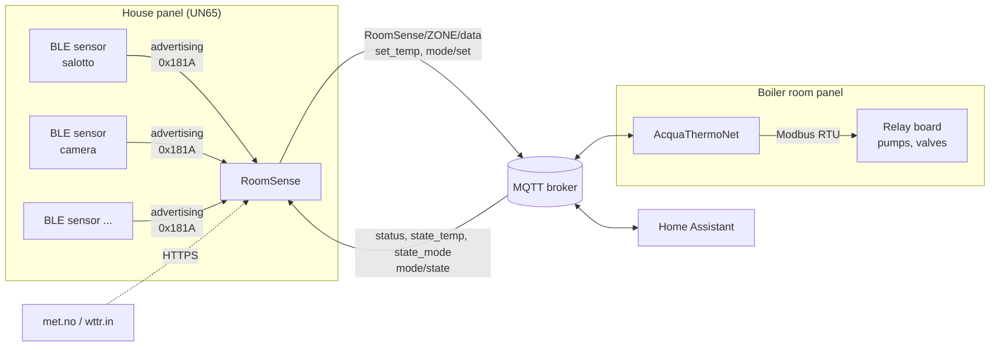
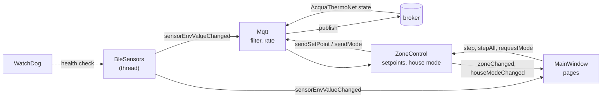
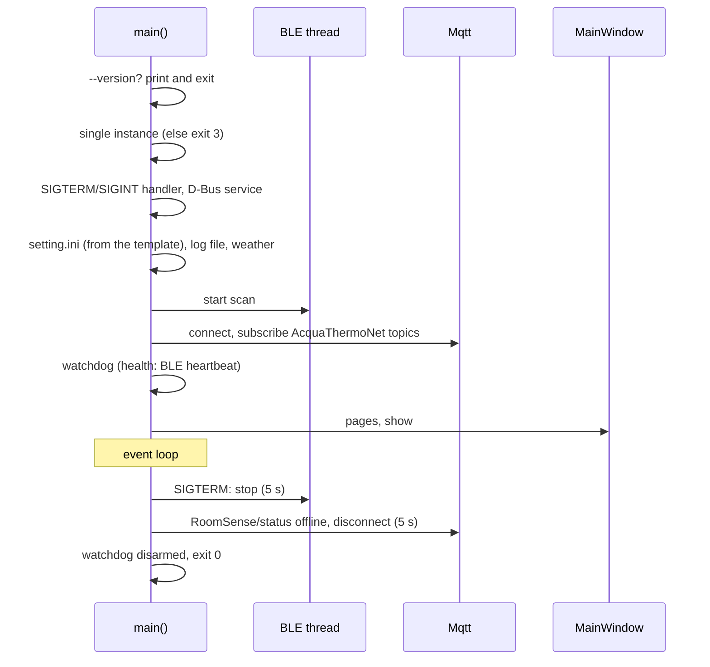
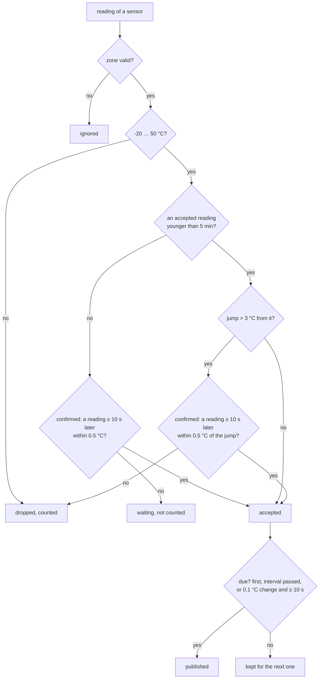

# RoomSense — Technical documentation

BLE sensor gateway and touch panel of the house. It reads the room
temperature sensors over Bluetooth Low Energy, publishes one reading per
zone over MQTT for **AcquaThermoNet**, the heating controller in the
boiler room, and shows the zones on a 600×1024 portrait touch panel: the
temperatures, the setpoints (changed through AcquaThermoNet), the house
mode, a screen saver with the outdoor weather.

This document describes version **3.0.0**, to be installed together with
AcquaThermoNet 3.0.0 (the reading topic changed).
The same content, with rendered diagrams, is in
[`RoomSense.html`](RoomSense.html). Build: [`BUILD.md`](BUILD.md); tests:
[`TESTING.md`](TESTING.md); deployment package:
[`../tools/package/README.md`](../tools/package/README.md).

The MQTT contract with AcquaThermoNet is **its** document
`HA_Hmi_Relay/docs/SENSOR_GATEWAY_INTERFACE.md` (the "interface" below,
§ numbers of that document): this one only says how RoomSense implements
it.

---

## Contents

1. [Overview](#1-overview)
2. [System architecture](#2-system-architecture)
3. [Software architecture](#3-software-architecture)
4. [Start and shutdown](#4-start-and-shutdown)
5. [BLE sensors](#5-ble-sensors)
6. [MQTT](#6-mqtt)
7. [Setpoints and house mode](#7-setpoints-and-house-mode)
8. [Chrono thermostat](#8-chrono-thermostat)
9. [User interface](#9-user-interface)
10. [Outdoor weather](#10-outdoor-weather)
11. [Logging](#11-logging)
12. [Reliability](#12-reliability)
13. [Configuration reference](#13-configuration-reference)
14. [Files on the device](#14-files-on-the-device)
15. [Build](#15-build)
16. [Deployment package](#16-deployment-package)
17. [Testing](#17-testing)
18. [Troubleshooting](#18-troubleshooting)
19. [Known limitations and backlog](#19-known-limitations-and-backlog)

---

## 1. Overview

| | |
|---|---|
| Application | `RoomSense`, Qt 5 Widgets, C++17 (formerly Thermonator: the repository folder keeps that name) |
| Target | UN65 HMI panel in the house (ARM32 Cortex-A9), 600×1024 portrait touch, custom init (no systemd), launched by JMLauncher |
| Development | Linux x86_64, Qt 5.13.2 (Qt 5.15 also builds); generated readings instead of BLE |
| Sensors | BLE thermometers with the atc1441 or pvvx custom firmware (service data 0x181A), one per zone |
| Peers | AcquaThermoNet (heating controller, another panel in the boiler room) and Home Assistant, only through the MQTT broker |
| D-Bus | session service `org.roomsense.RoomSense`, `show` / `hide` (optional) |

Main features:

- BLE passive scan, atc1441 and pvvx advertisements decoded, MAC checked
  inside the service data, implausible readings dropped (range, jumps not
  confirmed);
- one reading per zone on `RoomSense/<zone>/data` every
  `publish_interval_s` (60–300 s), earlier on a 0.1 °C change; **nothing**
  for a sensor no longer heard, so that AcquaThermoNet detects it (the
  topic was `RoomSense/apartment/<zone>/data` up to RoomSense 1.0.0 and
  AcquaThermoNet 2.4.0: update the two applications together);
- the house panel: one card per zone with temperature, humidity, battery,
  heating, sensor state and the setpoint −/+ (a command to
  AcquaThermoNet, shown as pending until it confirms);
- house mode for the whole house (windows open, away, boost) and "all
  rooms" −/+ from a popup;
- screen saver after a period without touches: clock, outdoor weather
  (met.no or wttr.in), a webcam image, alarms and rooms heating;
- diagnostic page (long press on the clock): system, sensors, log;
- hardware watchdog, single instance, clean shutdown on SIGTERM, a
  restart loop in the package.

---

## 2. System architecture

Two panels, far apart, each with its application in the foreground. They
never talk directly: only through the MQTT broker.



- **AcquaThermoNet owns the setpoints and the house mode**: RoomSense
  shows what it publishes (retained) and sends commands; it never keeps a
  setpoint of its own.
- **Home Assistant** reads the same reading topics (current temperature
  of its climate entities) and changes the setpoints like the panel.
- The **weather** is fetched by RoomSense itself, for its screen saver.

---

## 3. Software architecture

Two threads: the **BLE reader** (`QThread`, blocking HCI socket) and the
**main thread** (Qt event loop: MQTT, GUI, timers, watchdog).



| Class | Files | Role |
|---|---|---|
| `main()` | `main.cpp` | single instance, signals, D-Bus, configuration, threads, shutdown |
| `ConfigFile` | `configfile.*` | `setting.ini` (created from `setting.default.ini`), all the sections |
| `BleSensors` | `blesensors.*` | ARM only: HCI LE passive scan, reopen with backoff, heartbeat |
| `FakeBleData`, `FakeScenario` | `fakebledata.*`, `fakescenario.*` | desktop only: deterministic readings and events (`RS_FAKE`) |
| `BleParse` | `bleparse.*` | pure: HCI advertising reports, atc1441/pvvx decoding, MAC format |
| `Mqtt` | `mqtt.*` | broker connection, plausibility filter, publish rate, AcquaThermoNet topics |
| `ZoneControl` | `zonecontrol.*` | no MQTT inside: setpoints and house mode as AcquaThermoNet publishes them, pending commands |
| `Chrono` | `chrono.*` | pure: chrono program and state of a zone, editing steps (§8) |
| `ChronoPage`, `ChronoView`, `ChronoEditor` | `chronopage.*`, `chronoview.*`, `chronoeditor.*` | chrono page of a zone and program editor; pure texts (§8) |
| `MainWindow` | `mainwindow.*` | pages in a `QStackedWidget`, idle timer of the screen saver, show/hide |
| `MainPage`, `ZoneCard`, `ModePopup` | `mainpage.*`, `zonecard.*`, `modepopup.*` | main page, one card per zone, house popup |
| `ZoneView` | `zoneview.*` | pure: texts and states of a card and of the house button |
| `DiagPage`, `DiagView` | `diagpage.*`, `diagview.*` | diagnostic page; pure rows |
| `ScreenSaver`, `SaverView` | `screensaver.*`, `saverview.*` | screen saver; pure summary and weather view |
| `Weather` | `weather.*` | met.no / wttr.in polling (as AcquaThermoNet) |
| `WatchDog`, `Heartbeat` | `watchdog.*`, `heartbeat.h` | `/dev/watchdog`, refreshed while the BLE thread is alive |
| `SingleInstance` | `singleinstance.*` | abstract unix socket lock |
| `DbusManager` | `dbusmanager.*`, `roomsense.xml` | `show` / `hide` |
| `Logging`, `MonoClock` | `logging.*`, `monoclock.*` | categories, file rotation, recent messages; monotonic clock |

The rules (filters, texts, colours, pending states) are in pure,
unit-tested functions; widgets only display them. Colours are only in
`qss/default.qss` (dynamic properties `level`, `heat`, `setpoint`, `low`,
`dropped`, `active`).

---

## 4. Start and shutdown



Exit codes, as AcquaThermoNet: `0` stopped on purpose, `3` another
instance runs (`EXIT_ALREADY_RUNNING`), anything else a crash. The
package `start.sh` restarts on a crash only.

---

## 5. BLE sensors

### 5.1 Scan

- ARM build (`RS_BLE`): `hci1` if present, else `hci0`; LE passive scan,
  no duplicate filtering, socket filter on LE meta events.
- Errors (open, scan parameters, read, socket closed) and **120 s without
  any advertisement** close the device and open it again after 1, 2, 5,
  10, then 30 s. The thread never exits; it beats a heartbeat during the
  waits too.
- The package `start.sh` resets the Bluetooth module of the panel before
  the first start (GPIO 92, `rsi_usb dev_oper_mode=13`, `hciconfig hci0
  up`), see `tools/package/README.md`.

### 5.2 Formats

Only service data of UUID **0x181A** (Environmental Sensing) with the
lengths of the two custom firmwares of the Xiaomi LYWSD03MMC-like
thermometers:

| Format | AD length | MAC in the data | Temperature | Humidity | Battery |
|---|---|---|---|---|---|
| atc1441 | 16 | big endian | int16 BE, 0.1 °C | % | %, and mV BE |
| pvvx | 18 | little endian | int16 LE, 0.01 °C (rounded to 0.1) | 0.01 % (rounded) | mV LE, then % |

The MAC inside the data must be the advertiser's; any other format,
UUID, length or a malformed packet is ignored. A reading is passed on
only for a MAC of `[SENSORS]`.

### 5.3 Sensors and zones

`[SENSORS]`: one group per sensor with `mac`, `name`, `zone` (default:
the name). **One sensor per zone**: a second sensor on the same zone is
refused by the loader (logged) and not published. The zone must be a
valid AcquaThermoNet zone name (`[A-Za-z0-9_-]`, not `list` or `mode`),
case sensitive.

---

## 6. MQTT

### 6.1 Connection

| | |
|---|---|
| Broker | `[MQTT] broker_addr`:`broker_port` (empty: `localhost`, 1883); user and password only when both are set |
| Client id | `RoomSense-<unique_id>` (empty: the host name) |
| Keepalive | 30 s |
| Availability | `RoomSense/status` `online` / `offline`, retained; `offline` also as the Will |
| Reconnect | after 1, 2, 5, 10, then 30 s; a connection without CONNACK is dropped after 30 s |
| TLS | not yet (the broker has none today), §19 |

Clean session: the subscriptions are made again at every connection; the
retained AcquaThermoNet state arrives at once.

### 6.2 Topics

| Topic | Dir. | Payload | QoS | Retain | Interface |
|---|---|---|---|---|---|
| `RoomSense/status` | out | `online` / `offline` | 1 | yes | |
| `RoomSense/<zone>/data` | out | reading JSON (6.3) | 1 | no | §3–6 |
| `AcquaThermoNet/<zone>/set_temp` | out | plain number, e.g. `21.5` | 1 | no | §7 |
| `AcquaThermoNet/mode/set` | out | `normal` / `window` / `away` / `boost` | 1 | no | §8 |
| `AcquaThermoNet/status` | in | `online` / `offline` | | | §7 |
| `AcquaThermoNet/+/state_temp` | in | applied setpoint | | | §7 |
| `AcquaThermoNet/+/state_mode` | in | `heat` / `off` | | | §7 |
| `AcquaThermoNet/mode/state` | in | `{"mode":"window","remaining_s":1740}` | | | §8 |

### 6.3 Reading payload

```json
{"temperature":20.4,"humidity":48,"battery":85,"battmv":2950,
 "data_time":1791320000,"mac":"A4:C1:38:00:00:01"}
```

`temperature` is a JSON number in °C; `humidity`, `battery` and `battmv`
are omitted when unknown (0); `data_time` is the epoch of the
advertisement.

### 6.4 Filters and rate



- The first reading of a sensor, and the first one after 5 min without
  an accepted reading, has nothing to compare with: it waits for a
  confirming reading too (about 10 s more before the first publication;
  AcquaThermoNet tolerates 15 min of silence).
- Dropping is always safe, publishing a wrong value is not: the
  controller only refuses a temperature outside −30…60 °C (a decoding
  error); anything within it switches the zone.
- Nothing is buffered while disconnected and nothing is ever republished
  from a cache: a sensor not heard any more stops its zone topic, and
  AcquaThermoNet closes the zone after 15 min.
- The dropped readings are counted per sensor (diagnostic page,
  "filtered").

---

## 7. Setpoints and house mode

`ZoneControl` holds the state of the zones as AcquaThermoNet publishes it
and turns the presses on the panel into commands. It has no MQTT inside
(`Mqtt` feeds it and publishes what it asks): it is unit tested alone.

### 7.1 Setpoints (interface §7)

- The setpoint shown is the retained `state_temp`. A press shows the new
  value as **pending** (blue) at once; presses are collected for 1 s,
  then **one** `set_temp` per zone (rounded to 0.5, clamped to 5…25 as
  the controller does).
- Pending until a `state_temp` arrives after the command (the controller
  republishes it after every command, also when unchanged or clamped), or
  for 5 s; then the confirmed value is shown again.
- No command while AcquaThermoNet is not reachable: `status` not
  `online`, the broker disconnected, or no `state_temp` received for the
  zone. The last known value stays, grey.
- **All rooms** (house popup): − aligns every zone to the lowest
  setpoint shown, or lowers them all by 0.5 if already aligned; + the
  same with the highest; one command per zone.

### 7.2 House mode (interface §8)

| Mode | Every zone | Ends |
|---|---|---|
| `window` (windows open) | min(own, 8 °C) | 30 min, or `normal` |
| `away` | min(own, 15 °C) | `normal` |
| `boost` | max(own, 25 °C) | 30 min, or `normal` |

(Values of AcquaThermoNet `[MODES]`, which runs the mode, the timer and
the restore.) RoomSense sends `mode/set` at once and shows the request
as pending until `mode/state` arrives (or 5 s); `remaining_s` is counted
down locally (`MonoClock`). While a mode is active or pending, the zone
−/+ are disabled; `window` is not offered during `away`.

---

## 8. Chrono thermostat

AcquaThermoNet runs a weekly program per zone (since 2.4.0) and publishes
it (interface §9): the state on `<zone>/chrono`, the program on
`<zone>/chrono/profile`; it accepts `<zone>/chrono/set` (on/off) and
`<zone>/chrono/profile/set` (the whole program, or a reset). RoomSense
keeps no program of its own: `ZoneControl` holds what was published.

- **Zone card**: a chrono line next to the zone name: next change
  (`22:30 → 17.0°`), `manual → 22:30`, `chrono paused` (away), `off`,
  `saving…`; grey while the controller is offline, hidden without a chrono
  state. When AcquaThermoNet published a program the line is a button
  (with a chevron) that opens the chrono page of the zone.
- **Chrono page**: today's program with the time now and the next change,
  the week, the weekday and holiday profiles, chrono on/off; after a
  change `saved`, `refused` or `not confirmed`.
- **Editor** (Edit program): the profile on a large chart, slots as
  chips; the selected slot changed with big −/+ (time 15 min, setpoint
  0.5, repeated while held), previous/next, split, delete; weekday or
  holiday, on/off, copy to holiday, same as weekday, reset to the
  controller's. Save sends the whole program once (QoS 1, not retained);
  Cancel drops the copy. A program changed elsewhere meanwhile is
  reported before it is overwritten.
- `saving…` until `chrono/profile` arrives (5 s): the answer is compared
  with what was sent, sorted and rounded to 0.5; a different one means
  refused or rounded, and is shown.

---

## 9. User interface

Qt Widgets, 600×1024 portrait, dark, no designer forms. Pages in a
`QStackedWidget`: main page, diagnostic page, screen saver.

### 9.1 Main page

- **Header**: the clock (80 px) and the date; a **long press** (1 s) on
  the clock opens the diagnostic page (no hint, no PIN). In the middle
  the **house button**: the mode icon, its name and the time left
  (window, boost), "Sending…" while pending. On the right the controller
  and network state.
- **Offline banner** "Heating controller not reachable: setpoints are
  read only" while AcquaThermoNet is not reachable (broker disconnected or
  `status` not `online`).
- **One card per zone** (five fit without a scroll bar):

| Item | Content |
|---|---|
| name, heating | `Heating` (orange) or `Idle` from `state_mode`; `Off, no sensor` (red) for a lost sensor (AcquaThermoNet closed the zone) |
| temperature | 56 px, `--.-°` for a sensor lost or not heard yet (never an old value) |
| setpoint −/+ | 64×64 buttons; under the value `setpoint` (confirmed), `sending…` (blue, pending), `last known` (grey, controller offline), `no setpoint` (no `state_temp` yet), `no zone`; during a mode `windows open`, `away` (blue) or `boost` (orange) |
| humidity, battery | `Hum 48 %`, `Batt 85 %`; `Batt 15 % low` in red below 20 %; `--` when unknown |
| sensor state | `updated 2 min ago`; after 5 min `last reading … ago` (amber); after 15 min `NO SENSOR for …` (red); `no reading yet` |

### 9.2 House popup

Opened by the house button, a sheet from the bottom; closed by Close, a
press outside or 10 s without presses. "All rooms" −/+ (§7.1) and the
three modes Boost, Windows open, Away: the active one again goes back to
normal; Windows open is disabled while away. Icons are own SVG drawings
(`icons/`), rendered with QSvgRenderer (the panel needs libQt5Svg).

### 9.3 Diagnostic page

Back and three tabs:

- **System**: MQTT broker and state, client id, heating controller, BLE
  adapter (`hciN, scanning`, `error, retrying`, `simulated (desktop)`),
  last advertisement, watchdog, uptime, log file and size, weather and
  its last error;
- **Sensors**: per sensor name, MAC, RSSI, last reading, messages sent,
  readings dropped;
- **Log**: the last 200 messages (info and above).

### 9.4 Screen saver

After `[SCREENSAVER] idle_s` without presses (an event filter on the
whole application), from any page: clock (140 px), date, outdoor weather
(hidden after 3 h without data), the webcam image (`webcam_url`,
downloaded only while shown, 15 s timeout, the last good image kept),
alarms and house mode, a flame chip per room heating. A press goes back
to the main page and is consumed.

### 9.5 Show and hide

D-Bus session service `org.roomsense.RoomSense`, object `/`, interface
`org.roomsense.RoomSense.GuiInterface`, methods `show` and `hide`. Without
a session bus the gateway runs, only show/hide is missing.

---

## 10. Outdoor weather

As AcquaThermoNet (`weather.cpp`, ported), for the screen saver only:

| Provider | Needs | Notes |
|---|---|---|
| `metno` (default) | `lat`, `lon` (`altitude`, `contact` in the User-Agent) | `locationforecast/2.0/compact`, symbol code → `icons/wx-*.svg` |
| `wttr` | `location` | one-line answer, no icon |

Polled every `poll_s` (600 s, at least 60) all the time, with a quick
retry after a failure; HTTPS through the OpenSSL 1.1 of the panel.
Disabled without coordinates (metno) or location (wttr).

---

## 11. Logging

As AcquaThermoNet: categories `rs.app`, `rs.config`, `rs.mqtt`, `rs.ble`,
`rs.weather`; info and above to stderr and to the `[LOG] file` (relative
to `setting.ini`) with rotation at `max_kb`, keeping `files` old ones;
debug to stderr only. Every BLE reading:
`QT_LOGGING_RULES="rs.ble.debug=true"`. The MQTT password is never logged.
The last 200 messages are kept for the Log tab.

Typical lines:

```
I rs.app: RoomSense v3.0.0 (git 1a2b3c4, built 2026-10-07 18:30:00 UTC)
I rs.ble: Using hci0
I rs.ble: BLE scan started
I rs.mqtt: MQTT client id:  "RoomSense-house"
I rs.mqtt: Sensor salotto: jump 20.4 -> 28.4, waiting for confirmation
I rs.mqtt: Zone salotto: setpoint 21 sent to AcquaThermoNet
I rs.mqtt: House mode window sent to AcquaThermoNet
W rs.ble: No BLE advertisement for 120 s, restarting the scan
```

---

## 12. Reliability

| Risk | Handling |
|---|---|
| Event loop hang | hardware watchdog (`/dev/watchdog`, root) refreshed by a timer of the main thread: no refresh, the panel reboots |
| BLE thread hang | the refresh also needs the BLE heartbeat younger than 30 s; a failing adapter is not a hang (the thread keeps retrying) |
| Crash | the package `start.sh` restart loop (2, 4, 8, 16, 20 s) |
| Clean stop | SIGTERM/SIGINT: BLE stopped, `RoomSense/status offline`, disconnect, watchdog disarmed (magic close) |
| Two instances | abstract unix socket `RoomSense`: the second exits with 3; freed by the kernel on any exit, also SIGKILL |
| Broker down | reconnect with backoff; no buffering; AcquaThermoNet closes the zones after 15 min without readings |
| Wrong readings | range and jump filters (§6.4) |
| Controller down | setpoints and mode shown as last known, no commands |
| Wall clock jumps | ages and timeouts on the monotonic clock (`MonoClock`) |

---

## 13. Configuration reference

`setting.ini` in the working directory, created at the first start from
`setting.default.ini` (commented template, placeholders only). Invalid
values are logged (`Invalid X, using Y`) and replaced by the default.

### [MQTT]

| Key | Default | |
|---|---|---|
| `broker_addr` | – (`localhost`) | host or IP |
| `broker_port` | 1883 | |
| `broker_uname`, `broker_password` | – | used only when both are set; plain text, never logged |
| `unique_id` | – (host name) | client id `RoomSense-<unique_id>` |
| `publish_interval_s` | 120 | 60…300; earlier on a 0.1 °C change |

### [SENSORS]

One group per sensor:

| Key | | |
|---|---|---|
| `mac` | `A4:C1:38:00:00:01` | any case; an invalid one is never read |
| `name` | | shown on the panel |
| `zone` | (name) | AcquaThermoNet zone, case sensitive, `[A-Za-z0-9_-]`, not `list` or `mode`; one sensor per zone |

The sensor index (diagnostics, `RS_FAKE`) is the group order of QSettings:
alphabetical.

### [SCREENSAVER]

| Key | Default | |
|---|---|---|
| `idle_s` | 30 | 0 = off, else 10…3600 |
| `webcam_url` | – | `http`, `https` or `file`; empty: no image |
| `webcam_refresh_s` | 60 | 10…3600 |

### [WEATHER]

| Key | Default | |
|---|---|---|
| `provider` | `metno` | `metno` or `wttr` |
| `location` | – | name shown; the wttr.in place |
| `lat`, `lon`, `altitude` | – , – , 0 | metno |
| `contact` | – | e-mail or URL for the met.no User-Agent |
| `poll_s` | 600 | at least 60 |

### [LOG]

| Key | Default | |
|---|---|---|
| `file` | `log/RoomSense.log` (template) | relative to `setting.ini`; empty: no file |
| `max_kb` | 512 | |
| `files` | 3 | old files kept |

### Example

```ini
[MQTT]
broker_addr=<broker host>
broker_uname=<user>
broker_password=<password>
unique_id=house

[SENSORS]
salotto\mac=A4:C1:38:00:00:01
salotto\name=Salotto
salotto\zone=salotto

[SCREENSAVER]
idle_s=60
webcam_url=http://<camera>/snapshot.jpg

[WEATHER]
provider=metno
location=Home
lat=<latitude>
lon=<longitude>
contact=info@mail.com
```

---

## 14. Files on the device

Installed by the package in the JMLauncher folder `RoomSense/`:

| Path | |
|---|---|
| `deploy/RoomSense` | the application (stripped) |
| `deploy/hciconfig` | BlueZ tool for the Bluetooth reset |
| `deploy/start.sh` | Bluetooth reset, environment, restart loop |
| `deploy/setting.default.ini` | template |
| `deploy/setting.ini` | the configuration, created at the first start, kept across updates |
| `deploy/log/` | log files, kept across updates |
| `run.sh`, `stop.sh`, `install.sh`, `uninstall.sh`, `update.sh`, `package.info` | launcher hooks |

---

## 15. Build

Summary; commands in [`BUILD.md`](BUILD.md).

- qmake subdirs project `RoomSense.pro`: `ThirdParty` first (QtMqtt
  v5.13.2 static, always; libbluetooth and `hciconfig` from BlueZ 5.50,
  ARM only), then `app/app.pro`; `CONFIG+=tests` adds `tests/`.
- Desktop: Qt 5.13.2, fake BLE. Panel: the `Sdk/1.3.x` SDK (Cortex-A7)
  with `-mcpu=cortex-a9` (`RS_ARM_CPU`): the A9 has no hardware integer
  division.
- Version from the latest git tag `vX.Y.Z` when qmake runs (`version.pri`),
  `-<hash>` after it, `0.0.0` without a tag. Release tags live on the
  `public` branch: builds of `master` show `0.0.0-<hash>`.

---

## 16. Deployment package

Built after every ARM link: `<build>/dist/RoomSense_Package_Arm32_<version>.zip`
and the debug binary next to it. Hooks, Bluetooth reset and update
behaviour: [`tools/package/README.md`](../tools/package/README.md).

---

## 17. Testing

- **Unit tests** (`tests/`, QtTest, offscreen): 16 suites, no BLE, broker
  or display; the MQTT tests run an in-process broker
  (`tests/fakebroker.h`).
- **End to end** (`tools/e2e.sh`): RoomSense and the real AcquaThermoNet
  through the AcquaThermoNet simulators, in an isolated network
  namespace.
- **Real broker** (`tools/broker_check.sh`): publishes only on test zones
  the controller ignores.

What every test checks: [`TESTING.md`](TESTING.md).

---

## 18. Troubleshooting

| Symptom | Check |
|---|---|
| A zone shows `no reading yet` | the MAC in `[SENSORS]`; the sensor firmware (atc1441 or pvvx, advertising "custom" format); BLE debug log `rs.ble.debug=true`; Sensors tab |
| `BLE adapter: error, retrying` | `hciconfig` (adapter up?), the Bluetooth reset in syslog (tag `RoomSense`); the panel log |
| Readings shown but AcquaThermoNet sees nothing | the zone name (case, charset), `Sensor …: invalid zone name` or `already used` in the log; broker connected (System tab) |
| Many "dropped" in the Sensors tab | a sensor with jumps or out of range values: `rs.mqtt` log lines |
| −/+ disabled | controller offline, broker disconnected, no `state_temp` yet for the zone, or a house mode active |
| Setpoint goes back after 5 s | AcquaThermoNet did not confirm: its log and the broker |
| No weather | `[WEATHER]` coordinates or location; Weather row of the System tab (last error); HTTPS needs the OpenSSL 1.1 of the panel |
| No webcam image | `webcam_url` scheme and reachability; the JPEG image plugin of Qt on the panel |
| "Illegal instruction" | built without `-mcpu=cortex-a9`: `objdump -d RoomSense \| grep -cE '(s\|u)div'` must be 0 |
| Exits at once with code 3 | another RoomSense runs |

---

## 19. Known limitations and backlog

- **TLS** to the broker: postponed until the broker has it; then as
  AcquaThermoNet (same `[MQTT]` keys), with clear logs for a wrong clock
  and a warning before the certificate expires.
- Temperature chart: postponed.
- UI and log texts are English only; `tr()` translation may come later.
- To verify on the house panel: libQt5Svg, the JPEG plugin, HTTPS to
  met.no, the watchdog magic close, touch scrolling and sizes, the boot
  splash orientation (600×1024 portrait or 1024×600).
- Qt 6 port postponed.

### Planned

Nothing scheduled: the temperature chart and TLS above.
